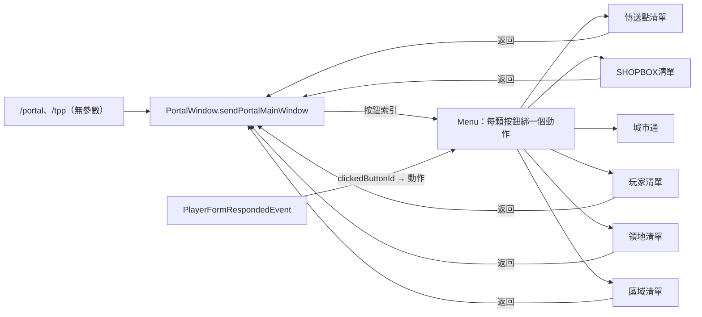

# 傳送選單視窗

視窗（表單）是 Nukkit 核心內建的 Bedrock 表單功能（`FormWindowSimple`），插件只決定標題、說明與按鈕。以前需要額外插件，現在不需要。

## 架構

- 每個視窗用 `Menu` 建立：加按鈕時同時綁定動作，回應事件只用**按鈕索引**取動作，不比對標題或按鈕文字，所以換語言、重名項目（兩個同名傳送點）都不會誤判。
- 視窗與玩家的對應用 `WeakHashMap`，不是該玩家開的視窗一律忽略。

## 使用者旅程

| 旅程 | 步驟 | 結果 |
|---|---|---|
| 傳到傳送點 | `/portal` → 傳送點 → 點某點 | 傳送；清單頂端有「返回」 |
| 傳到自己的領地 | `/portal` → 領地 → 點領地名 | 沒有領地時只顯示說明與「返回」 |
| 傳到玩家 | `/portal` → 玩家 → 點玩家名 | 送出 tpa 請求；只有自己在線時顯示無人可傳 |
| 收到 tpa | 彈出同意／取消視窗 | 同意則請求者傳送；關閉視窗等於取消 |

## 這次修正

1. 以按鈕索引取代標題／按鈕文字比對（為 en-US 做準備）。
2. 兩個「重名會多次傳送」的問題消失（原本以文字比對會對每個同名點都傳送）。
3. 領地、玩家清單從下拉式 + 「送出」改成按鈕清單，並補上「返回」（原本是死路，只能關閉再重開）。
4. tpa 視窗：請求者不在線或已被取代時安靜忽略。

## 與核心表單對照（Nukkit `cn.nukkit.form`）

| 核心元件 | 用在哪 | 設計 |
|---|---|---|
| `FormWindowSimple`（標題、內文、按鈕） | 主選單、各清單、tpa、住家 | 標題＝這是什麼（含頁碼）；內文＝一句引導（要點什麼）或沒有內容的說明；按鈕＝可做的事，第一顆固定「返回」，分頁與選項按鈕固定在最後 |
| `FormWindowCustom`（Label、Input、Dropdown、Slider） | 清單選項視窗 | Label 顯示總數；Input 搜尋關鍵字；Dropdown 排序（預設／依名稱）；Slider 每頁數量（範圍由 config） |
| `FormWindowModal`（兩顆按鈕） | 未使用 | 刪除確認目前沿用 Simple，可日後改 Modal |
| `ElementHeader`／`ElementDivider`／`ElementToggle`／`ElementStepSlider` | 未使用 | 目前沒有需要；排序若增加到 3 種以上可改 StepSlider |

## 清單的搜尋、排序、每頁數量

- 清單項目超過 `window-search-threshold`（預設 8）時，最後會多一顆「搜尋／排序／每頁數量」按鈕；搜尋中一定會顯示，方便清除。
- 搜尋：名稱包含關鍵字（不分大小寫）；沒有符合時內文提示並可重新搜尋。
- 排序：預設順序（資料原本順序）或依名稱。依距離排序需要座標，暫不做。
- 每頁數量：玩家用滑桿調整，範圍 `window-items-min`～`window-items-max`；設定存在記憶體，離開伺服器就清掉（「一次性」）。要永久保存可日後接 tokaProfiles 的玩家偏好。
- 管理員可改的預設值：`window-items-per-page`（10）、`window-items-min`（3）、`window-items-max`（30）、`window-search-threshold`（8），都在 config.yml 有繁中註解。

## 已知限制

- 清單沒有像 `/help` 那樣的指令搜尋；搜尋只在視窗內。
- 「SHOPBOX」「傳送點」即使沒有項目也會顯示在主選單，進去會顯示「目前沒有…」的提示與「返回」。

## 住家視窗（form/home/）

同樣改成按鈕索引：清單與編輯清單第一顆是「返回」（住家清單返回主選單、編輯清單返回住家清單）；沒有住家時只顯示說明與返回；刪除確認取消會回到該住家的編輯視窗，確認後回到編輯清單。`HomeSetForm` 只有輸入框，不變。
